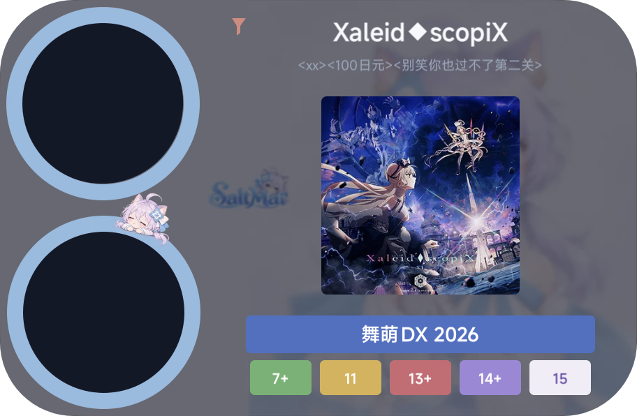

# 舞萌随机歌曲

适用于小米背屏的舞萌 DX 国服随机选曲模块，基于 [背屏卡片桥（Rear Card Bridge）](https://github.com/finall1008/rear-card-bridge) API 2 开发。

长按随机歌曲，支持等级、版本、谱面类型和难度筛选，并提供随机历史与次数统计。



## 功能

- **随机选曲**：长按触发随机动画，从符合条件的曲目和谱面中抽取。
- **自定义筛选**：支持等级范围、游戏版本、标准/DX 谱面和难度筛选。
- **歌曲别名**：合并落雪与 DXRating 别名，落雪优先、去重后每首最多保留三条。
- **曲绘加载**：通过 Cloudflare R2 按需获取 WebP 曲绘，并在本地缓存。
- **随机统计**：累计随机次数、今日随机次数、最近 15 条记录及歌曲随机次数 Top 10。
- **数据管理**：支持清除曲绘缓存、清空随机记录和重置统计次数。
- **设置记忆**：保留筛选条件及相关设置。

### 更多预览

[筛选设置](previews/filter.png) · [版本筛选](previews/version.png) · [统计与缓存管理](previews/settings.jpg)

## 安装

1. 安装支持 API 2 的 [背屏卡片桥](https://github.com/finall1008/rear-card-bridge)。
2. 从 [Releases](https://github.com/LahantziBade/saltmai-random/releases) 下载最新版 `saltmai-random-v版本号.zip`。
3. 在背屏卡片桥中使用「安装 ZIP 模块」导入。
4. 根据背屏卡片桥的提示选择载体、完成写入，并在系统背屏设置中应用卡片。

请下载 Release 附件中的模块 ZIP，不要使用 GitHub 自动生成的 Source code ZIP。

## 数据来源与更新

### 歌曲及谱面

曲库使用 [落雪咖啡屋 maimai DX 查分器](https://maimai.lxns.net/) 提供的国服歌曲数据。

根据歌曲及谱面配信状态生成可用曲库，过滤宴谱、禁用曲目和未到配信日期的内容。

### 歌曲别名

别名来自两个项目：

- **落雪咖啡屋**：主要别名来源，按歌曲 ID 匹配。
- **DXRating**：补充别名来源，按可唯一确定的歌曲名称匹配。

合并时优先保留落雪别名，去除重复项。为控制模块体积，每首歌曲最多保存三条别名。

### 曲绘资源

曲绘由落雪游戏资源接口提供原始素材，经尺寸缩放和 WebP 编码后存储于 Cloudflare R2。

背屏按需获取曲绘并保存在本地，无须在安装包内包含完整曲绘资源库。

### 曲库更新

通过 GitHub Actions 手动执行更新工作流：

1. 获取最新落雪歌曲与别名数据。
2. 与现有 DXRating 别名合并，生成内置曲库。
3. 对比 R2 已有曲绘，自动补充缺失的 WebP 文件。
4. 发布模式下更新模块版本、构建 ZIP 并发布 GitHub Release。

曲库和别名随模块版本更新，曲绘资源独立维护。

## 项目结构

```text
saltmai-random/
├── .github/workflows/    # GitHub Actions 工作流
├── card/                 # 背屏界面与交互
│   └── assets/          # 内置曲库和 UI 素材
├── webroot/              # 主屏设置、统计和缓存管理
├── data/                 # 曲库与别名原始数据
├── scripts/              # 曲库构建与曲绘处理脚本
├── previews/             # 商店预览图
└── module.json           # 模块信息
```

模块 ID：`dev.saltmai.random`

API Version：`2`

## 致谢

本项目的开发离不开以下项目提供的数据、工具、技术文档与实现经验，在此表示感谢。

### 数据来源

**[落雪咖啡屋 maimai DX 查分器（LXNS）](https://maimai.lxns.net/)**

感谢落雪项目维护国服歌曲、谱面、别名及游戏资源数据，并提供公开 API。本项目使用落雪作为主要曲库及别名数据来源。

- [API 文档](https://maimai.lxns.net/docs/api/maimai)
- [GitHub 项目](https://github.com/Lxns-Network/maimai-prober-frontend)

**[DXRating](https://github.com/gekichumai/dxrating)**

感谢 DXRating 项目提供舞萌 DX 相关数据与社区别名资源。本项目使用其别名数据补充落雪别名库。

- [DXRating 网站](https://dxrating.net)
- [GitHub 仓库](https://github.com/gekichumai/dxrating)

### 运行平台与构建工具

**[Rear Card Bridge / 背屏卡片桥](https://github.com/finall1008/rear-card-bridge)** · finall1008

感谢项目提供背屏模块运行环境、Bridge API、Canvas 绘制接口与模块构建工具。本项目基于其 API 2 模块规范开发。

**[Rear Card Modules / 背屏卡片桥模块商店](https://github.com/finall1008/rear-card-modules)** · finall1008

感谢模块商店项目提供模块展示、分发与更新渠道。

### 开发参考

**[xiaomi-backscreen-maimai-profile](https://github.com/finall1008/xiaomi-backscreen-maimai-profile)** · finall1008

舞萌背屏项目。开发过程中参考了其模块架构、主屏与背屏协作、图片预处理及缓存策略。

**[rear-card-endfield](https://github.com/misakayuuki/rear-card-endfield)** · misakayuuki

终末地背屏项目。开发过程中参考了其大图片处理、缓存生命周期及背屏运行环境的性能优化经验。

**[rear-card-hoyolab](https://github.com/finall1008/rear-card-hoyolab)** · finall1008

米游社背屏项目。开发过程中参考了其模块结构、页面交互与资源组织方式。

### 其他技术

- [Sharp](https://sharp.pixelplumbing.com/)：曲绘缩放与 WebP 编码。
- [Cloudflare R2](https://developers.cloudflare.com/r2/)：曲绘资源存储和分发。
- [GitHub Actions](https://docs.github.com/en/actions)：数据更新、模块构建与自动发布。

上述致谢不代表相关项目或其维护者参与开发、认可或赞助本项目。

## 声明

本项目是非官方的舞萌 DX 辅助工具，与 SEGA、游戏运营方及上述第三方项目不存在官方隶属关系。

游戏名称、歌曲、曲绘、角色及其他游戏相关素材的权利归各自权利人所有。第三方数据与开源项目的使用应遵守各自的服务条款和许可证。

本项目不提供游戏成绩修改、代打或游戏客户端修改功能。

---

**作者：** [Lahantzi](https://github.com/LahantziBade)

**项目地址：** https://github.com/LahantziBade/saltmai-random
